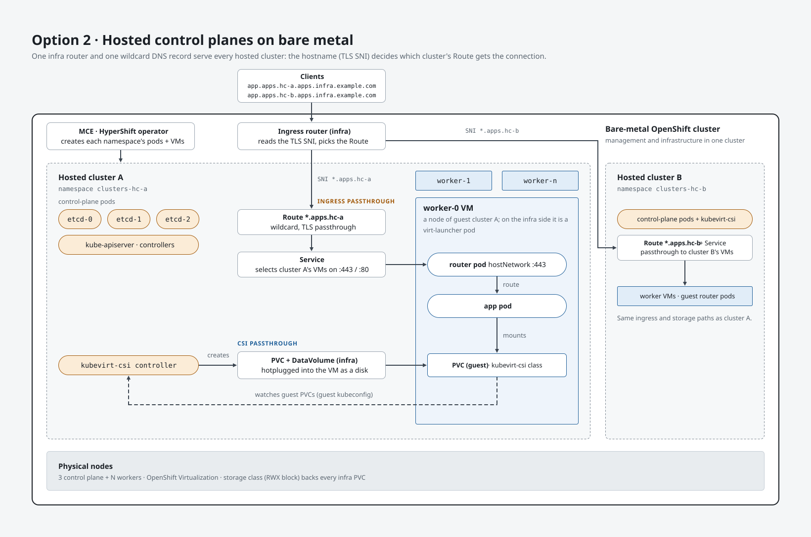

# OpenShift On-Premise Lab

Ansible automation for an OpenShift lab on a single bare-metal RHEL 9 host,
using KVM/libvirt for every VM: two standard OpenShift clusters, ACM/MCE
hosted control planes on them, backup and restore of a hosted cluster from one
hub to the other with OADP, and a set of self-contained labs on top - Ceph/ODF
storage, a three-node compact cluster, KubeVirt hosted clusters, GitOps, UDN
over BGP/EVPN and SPIFFE/SPIRE.

Each area lives in its own directory with its own README. This page covers what
every one of them shares - the bare-metal host, `vars.yaml`/`vault.yaml`, the
helper VM and the optional mirror registry - and points at the rest.

High-Level-Arch

## Contents

- [Repository layout](#repository-layout)
- [Architecture Overview](#architecture-overview)
- [Prerequisites](#prerequisites)
  - [Setup Bare Metal Host](#setup-bare-metal-host)
  - [vars.yaml](#varsyaml)
  - [vault.yaml (encrypted)](#vaultyaml-encrypted)
- [Shared setup](#shared-setup)
  - [Choose Connected or Disconnected](#choose-connected-or-disconnected)
  - [Setup Bare Metal Host](#setup-bare-metal-host-1)
  - [Resolving the lab's names from the hypervisor](#resolving-the-labs-names-from-the-hypervisor)
  - [Setup Mirror Registry (disconnected only)](#setup-mirror-registry-disconnected-only)
  - [Setup Bastion VM (optional)](#setup-bastion-vm-optional)
- [Hosted control planes, end to end](#hosted-control-planes-end-to-end)
- [Ceph 9 Storage for Hub PVs (ODF External Mode)](#ceph-9-storage-for-hub-pvs-odf-external-mode)
- [Three-node compact cluster](#three-node-compact-cluster)
- [Hosted clusters on the KubeVirt platform](#hosted-clusters-on-the-kubevirt-platform)
- [GitOps with Argo CD on hub1](#gitops-with-argo-cd-on-hub1)
- [UDN over BGP, VRF-Lite and EVPN (containerlab fabric)](#udn-over-bgp-vrf-lite-and-evpn-containerlab-fabric)
- [SPIFFE/SPIRE](#spiffespire)
- [Playbook Reference](#playbook-reference)
- [Key Roles](#key-roles)
- [Cleanup](#cleanup)

## Repository layout

| Directory | What it is | Start at |
| --- | --- | --- |
| *(root)* | The shared pieces: `vars.yaml`, `inventory/`, `roles/`, the bare-metal host and helper VM (`setup_bm_host.yaml`), the mirror registry and bastion playbooks, `cleanup.yaml` | this page |
| [`standard-cluster/`](standard-cluster/) | **cluster1** and **cluster2** - two independent OpenShift clusters (connected or disconnected), with LVM Storage when `use_lvm_storage: true`, and a playbook to shut either one down. cluster2 can be used for anything; the DR walkthrough uses it as the restore target | [standard-cluster/README.md](standard-cluster/README.md) |
| [`sno/`](sno/) | Single-node OpenShift clusters `sno` and `sno2` - the second cluster of the UDN, SPIFFE and KubeVirt labs | [sno/README.md](sno/README.md) |
| [`acm/`](acm/) | Turns a standard cluster (or the compact cluster) into a hosted-control-plane hub: ACM/MCE, MetalLB (with one API pool per hosted cluster) and the OADP operator; the AgentServiceConfig | [acm/README.md](acm/README.md) |
| [`hcp/`](hcp/) | Agent-platform hosted clusters on a hub: InfraEnv, worker VMs (ISO, PXE or BareMetalHost), the HostedCluster bundle, connected and disconnected | [hcp/README.md](hcp/README.md) |
| [`hcp/dr/`](hcp/dr/) | Back a hosted cluster up on cluster1 and restore it onto cluster2 with OADP - the DR walkthrough, its commands-only [steps.md](hcp/dr/steps.md) and [summary.md](hcp/dr/summary.md) | [hcp/dr/README.md](hcp/dr/README.md) |
| [`oadp/`](oadp/) | Generic OADP: the S3 bucket and IAM user, `setup_oadp.yaml`, the local MinIO S3 target for the disconnected lab, fs vs csi, a hello-openshift smoke test, troubleshooting | [oadp/README.md](oadp/README.md) |
| [`ceph/`](ceph/) | A standalone Ceph 9 cluster attached to a cluster through ODF external mode, instead of LVM Storage | [ceph/README.md](ceph/README.md) |
| [`compact-cluster/`](compact-cluster/) | A three-node compact cluster from one agent ISO, in the lab or on physical servers | [compact-cluster/README.md](compact-cluster/README.md) |
| [`kubevirt/`](kubevirt/) | Hosted clusters on the KubeVirt platform | [kubevirt/README.md](kubevirt/README.md) |
| [`gitops/`](gitops/) | OpenShift GitOps (Argo CD) on hub1, step by step | [gitops/README.md](gitops/README.md) |
| [`udn-bgp-evpn/`](udn-bgp-evpn/) | UDN over BGP, VRF-Lite and EVPN with a containerlab fabric | [udn-bgp-evpn/README.md](udn-bgp-evpn/README.md) |
| [`spiffe-spire/`](spiffe-spire/) | SPIFFE/SPIRE workload identity on hub1 and the SNO | [spiffe-spire/README.md](spiffe-spire/README.md) |
| [`terraform/`](terraform/) | `c5.metal` lab hosts on AWS, handed to Ansible | [terraform/README.md](terraform/README.md) |
| [`tests/`](tests/) | Sample workloads (microservices demo, Online Boutique) | [tests/](tests/) |

Every directory with playbooks has its own `ansible.cfg` that adds the shared
`roles/` to the role path, so **playbooks are run from inside their
directory**, with `-i ../inventory/hosts` (`-i ../../inventory/hosts` from
`hcp/dr/`). All of them share the root `vars.yaml`, `vault.yaml` and
`inventory/hosts`.

## Architecture Overview

```
┌──────────────────────────────────────────────────────────────┐
│  Bare Metal Host (RHEL 9 + KVM/libvirt)                      │
│                                                              │
│  ┌─────────────┐   ┌─────────────┐   ┌─────────────┐         │
│  │  Helper VM  │   │  cluster1   │   │  cluster2   │         │
│  │ (DNS + LB)  │   │ (OCP + ACM) │   │ (DR target) │         │
│  └─────────────┘   └──────-┬─────┘   └──────-┬─────┘         │
│                            │                 │               │
│                    ┌───────┴───────┐  ┌──────┴───────┐       │
│                    │ HCP Cluster 1 │  │ HCP Cluster 1│       │
│                    └───────────────┘  └──────────────┘       │
└──────────────────────────────────────────────────────────────┘
                             │                  │
                             ▼                  ▼
                    ┌────────────────────────────────┐
                    │  AWS S3 (shared backup bucket) │
                    └────────────────────────────────┘
```

**cluster1** (`hub`/hub1 in variable names) is the primary management cluster:
OpenShift with LVM Storage from [`standard-cluster/`](standard-cluster/), then
ACM, MetalLB and the OADP operator from [`acm/`](acm/). **cluster2**
(`hub2`) is a second, independent cluster; in the DR walkthrough it is the
replacement hub a hosted cluster is restored onto. Both hubs share the same S3
bucket, so backups created on cluster1 are visible to cluster2's Velero.

A cluster's PVs come from LVM Storage by default. They can instead come from a
standalone Ceph 9 cluster running on the same bare-metal host, consumed through
ODF external mode - see [ceph/README.md](ceph/README.md).

## Prerequisites
### Setup Bare Metal Host

- Start with a freshly installed RHEL 9.5+ bare-metal host with valid subscriptions.

```bash
subscription-manager register
yum install ansible-core -y
ansible-galaxy collection install community.libvirt
ansible-galaxy collection install community.crypto
```

- Download `rhel-9.8-x86_64-kvm.qcow2` (or latest RHEL 9 KVM image) from [access.redhat.com/downloads](https://access.redhat.com/downloads) and put it in `base_image_dir`:

```bash
git clone https://github.com/sadiquepp/ocp-onpremise.git
mkdir -p /opt/lab-images
cp rhel-9.8-x86_64-kvm.qcow2 /opt/lab-images/   # base_image_dir in vars.yaml
```

If using a different RHEL 9 KVM image, update `rhel9_kvm_image` in `vars.yaml`.

**Why `/opt/lab-images` and not `/var/lib/libvirt/images`.** On a host where
libvirt has never been installed the latter does not exist yet — the libvirt
RPM creates it, and this lab is what installs libvirt. So there is nowhere to
stage the image before the first run, and the only way forward is to
hand-create a path an RPM owns. On a fresh cloud metal instance that is not an
edge case, it is the first thing that happens. `/opt/lab-images` is owned by
nobody, so making it yourself is unremarkable.

`base_image_dir` is only ever *read* from, so it can be any directory you
control — including a mount point on a separate, larger volume, which is
where it belongs when the root disk is small.

> **Upgrading a lab built before this default changed?** The image is where
> you left it; only the variable moved. Either move the image to
> `/opt/lab-images`, or put `base_image_dir: "{{ download_dir }}"` back in
> `vars.yaml`. Both work.

`download_dir` is a different matter —
those are live VM disks, so moving *it* means giving the new path libvirt's
SELinux context:

```bash
semanage fcontext -a -t virt_image_t "/new/path(/.*)?" && restorecon -R /new/path
```

`setup_bm_host.yaml` creates both directories if they are missing, and fails
early — naming the path — if the base image has not been staged.

- For backups, an S3 bucket and an IAM user for OADP - created once per lab,
  as in [oadp/README.md](oadp/README.md#one-time-aws-setup-per-bucket-not-per-hub).
  Set `oadp_bucket_name` and `oadp_aws_region` in `vars.yaml` to match.

### vars.yaml

Review and adjust lab-specific values:

- Review the variables in `vars.yaml` and adjust them to your needs. Each section has a description of the variables and their purpose.
- [ip-allocation.md](ip-allocation.md) lists every address on the lab network in order, with the free ones, and the rules for picking a new one.

### vault.yaml (encrypted)
- Configure the vault.yaml file. All the values are mandatory unless marked optional below
 - Get org_id from [console.redhat.com](https://console.redhat.com)
 - Get activation_key from [console.redhat.com](https://console.redhat.com/insights/connector/activation-keys)
 - Get pull_secret from [console.redhat.com](https://console.redhat.com/openshift/install/pull-secret)
 - `ssh_key` is optional: `vars.yaml` defaults it to the lab key
   (`/root/.ssh/lab_rsa.pub`, generated by `setup_bm_host.yaml`). Set it to
   use your own public key on the hosted-cluster and bare-metal-infra nodes.
   The cluster1/cluster2 and SNO installs always use the lab key.
 - `oadp_aws_access_key_id` / `oadp_aws_secret_access_key` are only needed for
   OADP - the S3 bucket and IAM user they come from are created once, as in
   [oadp/README.md](oadp/README.md#one-time-aws-setup-per-bucket-not-per-hub).
 - `ceph_dashboard_password` is only needed if you run the Ceph flow
   (`ceph/setup_ceph.yaml`) - it is the initial password `cephadm bootstrap` sets for
   the Ceph dashboard's admin user (`ceph_dashboard_user` in `vars.yaml`).
   `ceph/setup_ceph.yaml` asserts it is present before it creates anything.
   See [ceph/README.md](ceph/README.md#requirements).
 - `mirror_registry_password` is only needed for the disconnected flow
   (`disconnected_install: true`) - it is the password the Quay
   `mirror-registry` appliance is installed with, and the one every later
   podman/oc-mirror login uses. `setup_mirror_registry.yaml` asserts it is
   present before it creates anything.

```bash
ansible-vault create vault.yaml
```

```yaml
org_id: XXXX
activation_key: YYYYY
pull_secret: 'ZZZZZ...'
ssh_key: 'ssh-ed25519 AAAA... you'   # optional - defaults to the lab key
oadp_aws_access_key_id: 'AKIA...'
oadp_aws_secret_access_key: '...'
ceph_dashboard_password: '...'   # only for the Ceph flow
mirror_registry_password: '...'  # only for the disconnected flow
```

## Shared setup

Everything below is shared by every directory: run it before the flows in
[Repository layout](#repository-layout).

### Choose Connected or Disconnected

`disconnected_install` in `vars.yaml` is the switch for the whole lab, and it is
the **source of truth**. Set it once, before you start:

```yaml
disconnected_install: false   # connected (default)
disconnected_install: true    # disconnected
```

Then run the workflow in order. Every playbook in it reads the flag, so the
commands and their order do not change - the same flow builds either lab:

| | `false` (connected) | `true` (disconnected) |
| --- | --- | --- |
| Mirror registry | not used | required, built first |
| cluster1 built (`standard-cluster/setup_cluster1.yaml`) | hub1, into `hub_install_folder` | hubd, into `hub_disconnected_install_folder` |
| cluster2 built (`standard-cluster/setup_cluster2.yaml`) | hub2 | hub2d |
| Hub pulls images from | quay.io / registry.redhat.io | the mirror registry, only |
| Hosted clusters rendered | `hosted_clusters` | `hosted_clusters_disconnected` |
| Hosted cluster workers | `.41-.43`, internet reachable | `.44-.46`, egress cut |
| MetalLB addresses used | `hub` (.160-.162) | `hubd` (.167-.169) |

Prefer editing `vars.yaml` over passing `-e disconnected_install=...` on a
single command. The flag decides which hub a step installs, which kubeconfig the
next step talks to and which cluster list it renders, so a run that disagrees
with the one before it quietly targets a hub you never built - and that usually
surfaces several steps later. The commands in this workflow are written without
it; the few genuine exceptions are called out where they appear.

The connected and disconnected clusters are fully independent - their own IP block (`ip_list.hubd_*`),
subdomain (`hub_disconnected_domain`) and VM/install directories - so a
connected and a disconnected lab co-exist happily. Flipping the flag and running
the flow again builds the second one without disturbing the first.

### Setup Bare Metal Host

Creates and configures the `helper` VM that provides DNS and HAProxy for the lab.

```bash
ansible-playbook -i inventory/hosts setup_bm_host.yaml --ask-vault-pass
```

### Resolving the lab's names from the hypervisor

`setup_bm_host.yaml` writes a marked block into `/etc/hosts` with every fixed
name the automation needs — `api` and `api-int` for each cluster, the console,
OAuth and downloads routes, and the helper. That is what makes an end-to-end
run deterministic: `nsswitch` reads `files` before `dns`, so those names answer
with no packet, no timeout and no dependency on the helper being up.

It is rendered from `ip_list` on every run and lives between markers, so it
cannot drift and anything you add outside the markers is left alone. Turn it
off with `lab_etc_hosts_manage: false`; extend the route list with
`lab_apps_routes`.

**Hosted-cluster `api`/`api-int` are deliberately absent.** Those follow
MetalLB VIPs that move between hubs at DR cutover — the reason the libvirt
network caps dnsmasq at `max-cache-ttl=60`. An `/etc/hosts` entry has no TTL
and silently outranks correct DNS, so pinning one there would reproduce the
stale-resolution failure that cap exists to bound. Only addresses that cannot
move belong in the block.

#### Do this once: point the host at the helper, so your own routes resolve

The block covers the names the *automation* uses. It cannot cover a route
**you** create — `/etc/hosts` has no wildcards, and your new route will simply
`NXDOMAIN` from the hypervisor while working perfectly from inside the
cluster.

The helper's zones do carry `*.apps` wildcards, so one step fixes it for
everything, now and later. **Run it after `setup_bm_host.yaml`** — the helper
has to exist first:

```bash
CON=$(nmcli -g GENERAL.CONNECTION device show "$(ip route show default | awk '{print $5; exit}')")
nmcli con mod "$CON" ipv4.dns 192.168.122.21 ipv4.dns-options timeout:1
nmcli con up "$CON"
```

Use `nmcli`, not an edit to `/etc/resolv.conf`: NetworkManager owns that file
and will overwrite a hand-edit on the next DHCP renew, reboot or `nmcli con
up`. Manually configured servers are written **before** the DHCP-learned ones,
so the helper is consulted first and your original resolver stays in the file
behind it.

That ordering is the safety net. If the helper is down, lookups cost the
`timeout:1` and then fall through to the DHCP resolver; if its `named` answers
SERVFAIL, glibc moves to the next server immediately. External names keep
working either way — the failure is slow, not broken. And because
`/etc/hosts` is still consulted first, the automation's own names never depend
on this at all.

Check it, and undo it if you want the host back the way it was:

```bash
cat /etc/resolv.conf                                     # helper first, then DHCP
getent hosts console-openshift-console.apps.hub.mylab.com
getent hosts whatever-route-you-made.apps.hub.mylab.com  # the wildcard at work

nmcli con mod "$CON" -ipv4.dns 192.168.122.21 && nmcli con up "$CON"
```

Over VNC on a cloud metal instance this is what makes the web console usable.
Browsing from your laptop instead, `ssh -D 1080` with SOCKS5 remote DNS gives
the browser the host's resolution, so every route name works with nothing
configured locally.

### Setup Mirror Registry (disconnected only)

**Skip this section entirely when `disconnected_install: false`.**

With `disconnected_install: true` this is a prerequisite for everything that
follows. Run it **after** `setup_bm_host.yaml` - it needs the helper's DNS to
resolve `registry.<hub_domain>` - and **before** any cluster is built, since a
disconnected install pulls every image from it:

```bash
ansible-playbook -i inventory/hosts setup_mirror_registry.yaml --ask-vault-pass
```

The playbook refuses to run unless `disconnected_install: true`, so it is the
one step that cannot be reached by accident from a connected lab.

It builds a standalone `registry` VM (`.22`), which stays connected to the
internet - it is the thing that holds the images - installs the Quay
`mirror-registry` appliance on it, and fills it with `oc-mirror` v2:

| Tag | Step |
| --- | --- |
| `mirror-vm` | creates the `registry` VM - a 500G sparse disk expanded from the RHEL9 base image with `virt-resize`, then defined and booted |
| `rhsm` | registers it with subscription-manager (hence `org_id` / `activation_key`) |
| `mirror` | installs `mirror-registry` (Quay + its root CA), logs podman in, renders `/root/mirror/imageset-config.yaml` and runs `oc mirror ... --v2` into the registry |
| `mirror-trust` | copies the registry's root CA into **this** host's trust store and logs the bare-metal host's podman in, writing `mirror_registry_authfile` (`/root/.docker/config.json`) |

Before running it:

- `mirror_registry_password`, `org_id` and `activation_key` must be in
  `vault.yaml` - the playbook asserts all three.
- Review the mirror block in `vars.yaml`: `mirror_registry_disk_size` (500G,
  sparse), `mirror_registry_memory` / `mirror_registry_vcpus`,
  `mirror_ocp_version` (defaults to
  `<ocp_major_version>.<ocp_minor_version>`, i.e. what the rest of the lab
  installs) and `mirror_catalog_operator_packages`. That last list is what gets
  mirrored beyond the release payload; it already covers the operators
  the clusters and `acm/` install (ACM, MCE, LVM Storage, MetalLB, OADP, cincinnati),
  so add anything else your lab needs **before** the mirror runs rather than
  after.
- Mirroring the release payload plus those catalogs pulls thousands of images -
  budget the disk and the time.

The `mirror-trust` step is what the rest of the flow actually reads: the cluster
install asserts the CA is at
`/etc/pki/ca-trust/source/anchors/mirror-registry-rootCA.pem` before it starts,
and `setup-bminfra` / `create-hosted-cluster` build their mirror-only pull
secrets from the authfile.

**If `oc-mirror` fails, do not rebuild the VM.** The registry, the tools, the
pull secret and the ImageSetConfiguration are all in place by then, and
oc-mirror v2 resumes from its workspace, so each attempt only pulls what is
still missing. Finish it by hand on the VM - the playbook prints this same
command when it fails:

```bash
ssh root@192.168.122.22
cd /root/mirror
oc mirror -c imageset-config.yaml --workspace file://oc-mirror-output/ \
  docker://registry.hub.mylab.com:8443 --v2
# logs: /root/mirror/oc-mirror-output/working-dir/logs/ and /root/mirror/.oc-mirror.log
```

Re-running the playbook's `mirror` tag will **skip** the mirror once the
registry answers `podman login`, which is why finishing it by hand is the way
out. When it completes, run the trust step and carry on:

```bash
ansible-playbook -i inventory/hosts setup_mirror_registry.yaml --ask-vault-pass --tags mirror-trust
```

Verify before building a cluster:

```bash
# on the bare-metal host - the two things every later step reads
ls -l /etc/pki/ca-trust/source/anchors/mirror-registry-rootCA.pem
grep -o 'registry[^"]*:8443' /root/.docker/config.json

# on the mirror-registry VM - what oc-mirror published for the cluster to apply
ssh root@192.168.122.22 'find /root/mirror/oc-mirror-output -type d -name cluster-resources'
```

That last directory holds the `ImageDigestMirrorSet` / `ImageTagMirrorSet` /
`CatalogSource` the cluster install stages and applies as day-2 resources; the
cluster install fails with a clear message if it is not there yet.

### Setup Bastion VM (optional)

A big-disk guest for building and scanning container images. Nothing else in the
lab depends on it, and nothing in the install flow imports it — run it when you
need it, skip it otherwise.

It exists because the bare-metal host does not have the room. Building container
images is disk-hungry: the hardened-vs-UBI image comparison in
[`sadiquepp/openshift`](https://github.com/sadiquepp/openshift/tree/main/test-workloads/online-boutique/hardened)
pulls a dozen base images, produces two full stacks of twelve service images,
and saves each one to a tar in order to scan it. On a host whose `/` is nearly
full that either fails partway or fills `/` — and filling `/` on the hypervisor
takes the whole lab with it.

```bash
ansible-playbook -i inventory/hosts setup_bastion.yaml --ask-vault-pass
```

256G disk, 8 vCPU, 16G RAM by default (`bastion_*` in `vars.yaml`). It reuses the
base image `setup_bm_host.yaml` prepared, so run that first. Registry trust and
login additionally need `setup_mirror_registry.yaml`; without it, run:

```bash
ansible-playbook -i inventory/hosts setup_bastion.yaml --ask-vault-pass \
  -e bastion_trust_mirror_registry=false -e bastion_registry_login=false
```

**If `/var/lib/libvirt/images` is itself on a small `/`,** point the disk
somewhere with room — that is the whole point of the exercise:

```bash
ansible-playbook -i inventory/hosts setup_bastion.yaml --ask-vault-pass \
  -e bastion_disk_dir=/data/libvirt/images
```

The role refuses to create the disk if the filesystem holding `bastion_disk_dir`
has less free space than `bastion_disk_size`, and names the filesystem and the
shortfall when it does. Pass `-e bastion_require_free_space=false` to overcommit
the sparse qcow2 on purpose.

**Tags can be used on their own.** Address discovery and the ssh wait are tagged
`always`, so the in-memory `bastion` group is rebuilt on every run regardless of
what else is selected — `--tags repos,scanners` works without recreating the VM.
That matters because the group is built by `add_host` and exists only for the
duration of a run; nothing is written to `inventory/hosts`.

**This VM has no address reservation.** Unlike helper and mirror-registry there
is no `ip_list` entry and no `ip-dhcp-host` entry on the `default` network — it
takes whatever libvirt's DHCP gives it, which is fine because nothing in the lab
needs to reach it at a predictable address. The playbook prints the address and
adds the host to the in-memory inventory for its own later plays. To find it
again:

```bash
virsh domifaddr bastion
```

**The clone is pinned to a branch.** `main` in `sadiquepp/openshift` does not yet
carry `test-workloads/online-boutique/hardened` — the build and scan tooling this
bastion exists to run — so `bastion_git_repos` pins that entry to the branch that
does. Drop the `version:` line once it merges, otherwise the paths in
`/root/.bastion-env` point at a directory that is not there.

What it installs: podman, buildah, skopeo, git, jq and friends; `grype` with its
vulnerability database primed (~1GB, pre-pulled so the first scan does not pay
for it, and so a database that downloads but cannot unpack fails here rather
than mid-comparison); `oc` and `kubectl`; the mirror registry's CA in the trust
bundle plus a `podman login` to it; and a clone of `sadiquepp/openshift` under
`/root/work`. `trivy` is available but off by default (`bastion_install_trivy`)
— the two scanners use different databases, so the second is a cross-check
rather than a requirement.

Then, on the bastion:

```bash
source /root/.bastion-env     # sets REGISTRY and NAMESPACE
cd /root/work/openshift/test-workloads/online-boutique/hardened
./preflight.sh --build-check
```

Extra dnf repositories, if the packages you want are not in the subscription's,
go in `bastion_extra_dnf_repos` (passed through to `yum_repository`); extra RHSM
repository IDs go in `bastion_rhsm_repos`.

## Hosted control planes, end to end

The core flow of this repository, one directory at a time. The commands-only
version, with Ceph storage and the CSI backup method, is
[hcp/dr/steps.md](hcp/dr/steps.md); what it proves is
[hcp/dr/summary.md](hcp/dr/summary.md).

| # | Directory | What | Playbook |
| --- | --- | --- | --- |
| 1 | root | Bare-metal host and helper VM (DNS, DHCP, haproxy) | `setup_bm_host.yaml` |
| 2 | root | Mirror registry - disconnected only | `setup_mirror_registry.yaml` |
| 3 | [`standard-cluster/`](standard-cluster/README.md) | cluster1, with LVM Storage (or `use_lvm_storage: false` and [`ceph/`](ceph/README.md) for Ceph) | `setup_cluster1.yaml` |
| 4 | [`acm/`](acm/README.md) | ACM/MCE, MetalLB and the OADP operator on cluster1; review and apply the AgentServiceConfig | `setup_acm.yaml` |
| 5 | [`hcp/`](hcp/README.md) | InfraEnv, worker VMs, hosted cluster(s), a sample workload | `setup_bminfra.yaml`, `setup_hosted_cluster_vm.yaml`, `create_hosted_cluster.yaml` |
| 6 | [`oadp/`](oadp/README.md) | OADP wired to the S3 bucket | `setup_oadp.yaml` |
| 7 | [`hcp/dr/`](hcp/dr/README.md) | Back the hosted cluster up, shut cluster1 down, build cluster2 (+ `acm/`, `oadp/` with `-e target_hub=hub2`), restore, cut DNS over | `backup_hosted_cluster.yaml`, `standard-cluster/shutdown_cluster.yaml`, `restore_hosted_cluster.yaml` |

```bash
cd standard-cluster && ansible-playbook -i ../inventory/hosts setup_cluster1.yaml --ask-vault-pass && cd ..
cd acm && ansible-playbook -i ../inventory/hosts setup_acm.yaml --ask-vault-pass && cd ..
```

> **Upgrading from a checkout where these playbooks sat at the repository
> root?** `setup_hub_cluster.yaml` and `setup_hub_cluster2.yaml` are now
> `standard-cluster/setup_cluster1.yaml` and `setup_cluster2.yaml`, and **no
> longer install ACM/MetalLB/OADP** - run `acm/setup_acm.yaml` after them
> (`--tags acm` and `--tags metallb` runs become `acm/setup_acm.yaml` and
> `acm/setup_acm.yaml --tags metallb`). The hosted-cluster playbooks moved to
> `hcp/`, the backup/restore/shutdown playbooks and their templates to
> `hcp/dr/`, `setup_oadp.yaml` and `setup_minio.yaml` to `oadp/`,
> `setup_sno.yaml` and `setup_sno2.yaml` to `sno/`, and `shutdown_hub_cluster.yaml`
> became `standard-cluster/shutdown_cluster.yaml` (any of the four clusters, by
> `target_hub` / `disconnected_install`). The compact cluster's `--tags acm` is
> `acm/setup_acm.yaml -e target_hub=compact`. The unused `gitops-manifests/`
> and `roles/setup-gitops` are gone (see [`gitops/`](gitops/)). Variable names,
> `target_hub` values and rendered-file locations under `roles/` are unchanged.

## Ceph 9 Storage for Hub PVs (ODF External Mode)

**Lives in [`ceph/`](ceph/).** A standalone Red Hat Ceph Storage 9 cluster -
`ceph1`-`ceph3` (mon + mgr + osd) and `cephadmin` (`.24`-`.27`) - built on the
same bare-metal host and handed to a hub through OpenShift Data Foundation in
external mode. It replaces LVM Storage as the hub's PV provider
(`use_lvm_storage: false`) and is what provides the CSI VolumeSnapshotClass the
`csi` backup method needs - see
[hcp/dr/README.md](hcp/dr/README.md#choose-how-the-control-plane-volumes-are-captured).
Everything about building, attaching, verifying and tearing it down - sizing,
the OCP 4.21+ requirement, the `ceph_dashboard_password` vault entry, and why it
should not share `openshift-storage` with LVM Storage - is in
[ceph/README.md](ceph/README.md).

Additive like the compact cluster below: it shares `vars.yaml`, `vault.yaml`,
`inventory/hosts` and `roles/`, and no other playbook imports it. Run its
playbooks from inside the directory:

```bash
cd ceph
ansible-playbook -i ../inventory/hosts setup_ceph.yaml --ask-vault-pass
ansible-playbook -i ../inventory/hosts setup_ceph_odf.yaml --ask-vault-pass
```

## Three-node compact cluster

**Lives in [`compact-cluster/`](compact-cluster/).** A three-node compact
OpenShift cluster from one agent ISO, every node's address on a bond over two
NICs: in the lab (connected, or disconnected from the mirror registry) and on
physical servers with LACP. The connected one can also be a management
cluster for hosted control planes, side by side with the hub
([compact-cluster/compact-cluster-hcp.md](compact-cluster/compact-cluster-hcp.md)).
Start with [compact-cluster/README.md](compact-cluster/README.md).

Additive like the UDN lab below: it shares `vars.yaml`, `vault.yaml`,
`inventory/hosts` and `roles/`, but nothing in the cluster, hosted-cluster or OADP
flows reads it. Run its playbooks from inside the directory:

```bash
cd compact-cluster
ansible-playbook -i ../inventory/hosts setup_compact_cluster.yaml --ask-vault-pass
```

## Hosted clusters on the KubeVirt platform

**Lives in [`kubevirt/`](kubevirt/).** A hosted cluster (`hcp-kv1`) whose
workers are KubeVirt VMs that its NodePool creates on the hub's OpenShift
Virtualization. On this lab they are nested VMs, so there's no ISO and no
Agent to approve. Ingress goes through the hub's router by default, with
MetalLB inside the hosted cluster as a per-cluster toggle. The host, Ceph and
hub1 are built with the same playbooks as [hcp/dr/steps.md](hcp/dr/steps.md); the
directory automates only the rest. Every command, start to finish, in
[kubevirt/steps.md](kubevirt/steps.md); explanations in
[kubevirt/README.md](kubevirt/README.md).



*The default layout, ingress and storage both passed through the
infrastructure cluster: hub1 in this lab, with `*.apps.hub.mylab.com` and
hcp-kv1 as hosted cluster A.
[kubevirt/README.md, Ingress](kubevirt/README.md#ingress-the-hubs-router-or-metallb)
explains it.*

hcp-kv1 is an ordinary `hosted_clusters` entry with `platform: kubevirt`, so
`setup-dns` and `setup-hub-acm` give it its API name and pool.
`hcp/create_hosted_cluster.yaml` skips it. `hcp-kv2` is the same with
`infra: sno`: its control plane on the hub, its worker VMs on the single-node
cluster ([kubevirt/README.md](kubevirt/README.md#workers-on-another-cluster-hcp-kv2-on-the-sno)).
`hcp-kv3` adds a third cluster: its control plane on `sno3`, a second SNO that
runs MCE alone, managed from hub1's ACM
([kubevirt/README.md](kubevirt/README.md#three-clusters-acm-on-hub1-mce-on-sno3-vms-on-the-sno-hcp-kv3)).
Run the playbook from inside the directory:

```bash
cd kubevirt
ansible-playbook -i ../inventory/hosts setup_hosted_cluster_kubevirt.yaml --ask-vault-pass
```

## GitOps with Argo CD on hub1

**Lives in [`gitops/`](gitops/).** Red Hat OpenShift GitOps on hub1, learned
step by step: the operator, then one application (Online Boutique) deployed by
Argo CD from git, with exercises on drift, self-heal and prune. Manifests and
`oc` only, no playbook. Each step notes what production does differently.
The aim is to deploy the KubeVirt hosted clusters the same way later.
Start at [gitops/README.md](gitops/README.md).

## UDN over BGP, VRF-Lite and EVPN (containerlab fabric)

**Moved to [`udn-bgp-evpn/`](udn-bgp-evpn/).** The whole lab - the two roles,
the playbook, the scripts and the documentation - lives in that directory now.

Entirely additive to this repository: nothing in the cluster, hosted-cluster, OADP
or Ceph flows reads any of it, and none of those flows change whether or not
you ever run it.

| Document | What it covers |
| --- | --- |
| [udn-bgp-evpn/README.md](udn-bgp-evpn/README.md) | Overview, the phase sequence, the playbook reference and the traps |
| [udn-bgp-evpn/udn-bgp-evpn-steps.md](udn-bgp-evpn/udn-bgp-evpn-steps.md) | Build it step by step, branched by transport |
| [udn-bgp-evpn/workshop.md](udn-bgp-evpn/workshop.md) | The workshop: one command for the lab, then the BGP/EVPN/UDN objects by hand |
| [udn-bgp-evpn/bgp-evpn.md](udn-bgp-evpn/bgp-evpn.md) | The cluster side, in depth |
| [udn-bgp-evpn/clab-fabric.md](udn-bgp-evpn/clab-fabric.md) | The fabric side, in depth |

It shares this repository's `vars.yaml`, `vault.yaml` and `inventory/hosts`,
and is run from inside its own directory:

```bash
cd udn-bgp-evpn
ansible-playbook -i ../inventory/hosts setup_udn_bgp_lab.yaml --ask-vault-pass --tags fabric
```

The cluster it peers with is still built from here - see
[udn-bgp-evpn/udn-bgp-evpn-steps.md](udn-bgp-evpn/udn-bgp-evpn-steps.md) for
the order.

## SPIFFE/SPIRE

**Lives in [`spiffe-spire/`](spiffe-spire/).** SPIFFE/SPIRE workload identity
on hub1 and the SNO, built on top of the base lab with its own `build-lab.sh`
and workshop. Start at [spiffe-spire/README.md](spiffe-spire/README.md).

## Playbook Reference

Every playbook is run with an inventory - `-i inventory/hosts` from the root,
`-i ../inventory/hosts` from a subdirectory. Most plays target `localhost`, but
they reach the lab VMs through `delegate_to` - the helper, the mirror registry,
minio, `ceph1`, `cephadmin` - and a delegated host that is not in the inventory
gets no `ansible_ssh_private_key_file` or `StrictHostKeyChecking=no`, so the SSH
fails or hangs on a host-key prompt. `ceph/setup_ceph.yaml` goes further and has
a play against the `ceph_nodes` group, which does not exist at all without `-i`.
Passing it everywhere keeps one habit instead of a rule about which playbook
needs it. Playbooks in a subdirectory are run from inside it, because each
directory's `ansible.cfg` is what adds the shared `roles/` to the role path.

`inventory/hosts` is generated from `inventory/hosts.j2` and `vars.yaml`
(`lab_network_prefix` + `ip_list`) by `setup_bm_host.yaml`, which re-reads it in
the same run so its own delegated tasks use what it just wrote. The copy in git
is the render of the defaults; if you change `lab_network_prefix` or `ip_list`,
re-run that playbook (its first task is enough) before running anything that
delegates.

| Playbook | Description |
| --- | --- |
| `setup_bm_host.yaml` | Prepare bare metal, create helper VM (DNS/LB) |
| `setup_mirror_registry.yaml` | Build the mirror registry VM and fill it with oc-mirror - required first when `disconnected_install: true`, refuses to run otherwise |
| `setup_bastion.yaml` | Build the 256G bastion VM for container image builds and CVE scanning - optional, nothing else depends on it |
| `oadp/setup_minio.yaml` | Build the MinIO VM, a local S3 target for the disconnected flow |
| `sno/setup_sno.yaml` / `sno/setup_sno2.yaml` | Single-node OpenShift clusters (used by the UDN, SPIFFE and KubeVirt labs) - see [sno/README.md](sno/README.md) |
| `cleanup.yaml` | Destroy all VMs, or one piece with `--tags hub\|hub2\|hubd\|hub2d\|hosted\|helper\|minio\|ceph\|sno\|compact\|...` (see [Cleanup](#cleanup)). The mirror registry is only shut down; `--tags registry-destroy` really removes it |
| `standard-cluster/setup_cluster1.yaml` | Deploy cluster1 (+ LVM Storage): hub1, or hubd when `disconnected_install: true` |
| `standard-cluster/setup_cluster2.yaml` | Deploy cluster2 (+ LVM Storage): hub2, or hub2d when `disconnected_install: true` |
| `acm/setup_acm.yaml` | Install ACM/MCE, MetalLB and the OADP operator on cluster1 (cluster2 with `-e target_hub=hub2`, the compact cluster with `-e target_hub=compact`), create the hosted clusters' MetalLB pools, render the AgentServiceConfig |
| `hcp/setup_bminfra.yaml` | Create the InfraEnv (namespace, pull secret, RBAC) and download its discovery ISO |
| `hcp/setup_hosted_cluster_vm.yaml` | Create a hosted cluster's worker VMs; builds the disconnected set when `disconnected_install: true`, BareMetalHosts with `hosted_cluster_worker_provisioning=bmh` |
| `hcp/setup_hosted_cluster2_vm.yaml` | Create `hcp-cluster2`'s worker VMs, PXE-booted |
| `hcp/create_hosted_cluster.yaml` | Render the HostedCluster/NodePool bundle; renders the disconnected clusters when `disconnected_install: true` |
| `hcp/setup_sushy_emulator.yaml` / `hcp/cleanup-sushy-emulator.yaml` | Run / remove the Redfish BMCs for BareMetalHost workers |
| `hcp/dr/backup_hosted_cluster.yaml` | Backup a hosted cluster control plane |
| `hcp/dr/restore_hosted_cluster.yaml` | Restore a hosted cluster control plane |
| `standard-cluster/shutdown_cluster.yaml` | Gracefully stop a standard cluster's VMs - cluster1 by default (preserves disks) |
| `oadp/setup_oadp.yaml` | Wire OADP to S3 (credentials + DPA) |
| `ceph/setup_ceph.yaml` | Build the standalone Ceph 9 cluster (ceph1-3 + cephadmin) - see [ceph/README.md](ceph/README.md) |
| `ceph/setup_ceph_odf.yaml` | Install ODF and attach that Ceph cluster to a cluster in external mode |
| `compact-cluster/setup_compact_cluster.yaml` | The three-node compact cluster - see [compact-cluster/README.md](compact-cluster/README.md) |
| `kubevirt/setup_hosted_cluster_kubevirt.yaml` | KubeVirt-platform hosted clusters - see [kubevirt/README.md](kubevirt/README.md) |
| `udn-bgp-evpn/setup_udn_bgp_lab.yaml` | Build the containerlab BGP/EVPN provider fabric and wire a cluster into it. Phase-tagged: `--tags fabric\|preflight\|default\|shared\|vrflite\|evpn` |
| `spiffe-spire/setup_spiffe_spire.yaml` | SPIFFE/SPIRE - see [spiffe-spire/README.md](spiffe-spire/README.md) |

## Key Roles

All roles live in [`roles/`](roles/) (plus the lab-specific ones under
`kubevirt/roles/`, `udn-bgp-evpn/roles/` and `spiffe-spire/roles/`), wherever
the playbook that uses them lives.

| Role | Responsibility |
| --- | --- |
| `setup-hub-cluster`, `setup-hub-cluster2` (+ `-disconnected`) | Install cluster1 / cluster2 as KVM/libvirt UPI clusters, connected or from the mirror registry - run by `standard-cluster/` |
| `setup-lvm-storage` | Installs LVM-Storage (operator + `LVMCluster`) and waits for the `lvms-vg1` default StorageClass. Run by the cluster builds (tag `lvm`) and the SNO's `snostorage` step; skipped when `use_lvm_storage: false` |
| `setup-hub-acm` | Installs ACM, MetalLB, and OADP operator subscriptions, and creates one single-address MetalLB `IPAddressPool` + `L2Advertisement` per hosted cluster - run by `acm/setup_acm.yaml` |
| `setup-bminfra` | The InfraEnv, its pull secret and RBAC, and the discovery ISO download - run by `hcp/setup_bminfra.yaml` |
| `create-hosted-cluster` | Renders the HostedCluster/NodePool/ManagedCluster/KlusterletAddonConfig bundle per hosted cluster - run by `hcp/create_hosted_cluster.yaml` |
| `setup-sushy-emulator` | Redfish BMCs for the hosted cluster workers (BareMetalHost path) |
| `setup-oadp` | Creates the cloud-credentials secret and DataProtectionApplication CR; with `oadp_backup_method=csi` also labels the VolumeSnapshotClass Velero selects CSI snapshot classes by - run by `oadp/setup_oadp.yaml` |
| `setup-bastion-vm` | Creates the bastion VM: preflights free space where the disk will live, expands the prepared RHEL 9 base image into a 256G sparse qcow2, imports it, then discovers its DHCP address and adds it to the in-memory inventory (no reservation, unlike every other VM in this lab) |
| `setup-bastion` | The in-guest half: build and scan tooling (podman/buildah/skopeo, grype with its db primed, optional trivy), `oc`, the mirror registry's CA and login, and a clone of `sadiquepp/openshift` under `/root/work` |
| `setup-ceph-vm` | Creates the ceph1-3 + cephadmin VMs and attaches the raw OSD disks |
| `setup-ceph-prereqs` | Registers the Ceph nodes with subscription-manager (no Satellite), enables the RHCS 9 tools repo, installs cephadm, and installs `pull_secret` as each node's podman authfile |
| `setup-ceph-cluster` | Runs `cephadm bootstrap` on ceph1, expands the cluster onto ceph2/ceph3 + cephadmin, places mon/mgr/osd daemons, and enables msgr2 |
| `setup-ceph-odf-export` | Creates the RBD pool (+ optional CephFS) and runs the version-matched exporter on cephadmin to produce the connection JSON |
| `setup-ceph-odf-consumer` | Installs the ODF operator and extracts its exporter script (stage `install`), then creates the external-cluster secret and `StorageCluster` (stage `create`) |
| `udn-bgp-evpn/roles/setup-clab-fabric` | Creates the isolated fabric bridge (virbr1), adds a second NIC to each OCP node VM, optionally builds the containerlab VM, and deploys the FRR topology (single border leaf, or leaf/spine/leaf for EVPN) |
| `udn-bgp-evpn/roles/setup-udn-bgp` | The cluster half: enables FRR + route advertisements, addresses the fabric NICs via NMState, creates the tenant CUDNs and workloads, and applies the phase's `FRRConfiguration`/`RouteAdvertisements`. Discovers each node's live UDN VRF before writing any VRF-Lite policy |

## Cleanup

Everything is torn down by one playbook, `cleanup.yaml`. With no tags it
removes every VM of the lab - cluster1 (hub1), cluster2 (hub2), their
disconnected builds hubd and hub2d, the hosted cluster workers, the helper, MinIO, Ceph, the SNOs, the
compact clusters and the UDN lab:

```bash
ansible-playbook -i inventory/hosts cleanup.yaml
```

Name one or more pieces with `--tags` to remove only those. Each leaves the
others alone - none of them touches S3 backups:

| Tag | Removes |
|-----|---------|
| `hub` | cluster1 (hub1): VMs, VM folder, install folder |
| `hub2` | cluster2 (hub2), the same way |
| `hubd` | the disconnected cluster1, plus its staged oc-mirror manifests and egress-blocking iptables rules |
| `hub2d` | the disconnected cluster2, the same way |
| `hosted` | the hosted clusters' worker VMs (`c1_worker*`, `c1-d-worker*`) |
| `helper` | the helper VM |
| `registry` | shuts the mirror registry down (it is kept - see below) |
| `minio` | the MinIO VM |
| `ceph` | the Ceph VMs and their OSD disks |
| `sno`, `sno2` | the single-node clusters |
| `compact`, `compacthcp`, `compactd` | the compact clusters (see the header of `cleanup.yaml`) |
| `udnlab` | the UDN/BGP/EVPN lab |

```bash
ansible-playbook -i inventory/hosts cleanup.yaml --tags hub
ansible-playbook -i inventory/hosts cleanup.yaml --tags hubd,hub2d
```

The **mirror registry is the exception**: that run only shuts it down. Its VM,
its 500G disk and everything `oc-mirror` put there are kept, so a later
disconnected run starts with `virsh start registry` instead of mirroring tens
of gigabytes again. This host's CA trust and podman login for it are left in
place too, and still match. To remove it for good:

```bash
ansible-playbook -i inventory/hosts cleanup.yaml --tags registry-destroy
```

That destroys and undefines the VM, deletes both disks, and removes the CA and
the podman login - a rebuilt registry gets a new CA, and a stale one makes a
disconnected run fail on TLS instead of stopping with a clear message. Keep
them with `-e mirror_registry_remove_local_trust=false`. `registry-destroy` is
tagged `never`, so neither a plain run nor `--tags all` reaches it.

Remove the Ceph cluster (VMs + OSD disks; leaves the clusters alone). ODF on the
hub is not touched - delete the `StorageCluster` there first if you are tearing
the whole thing down:

```bash
ansible-playbook -i inventory/hosts cleanup.yaml --tags ceph
```

